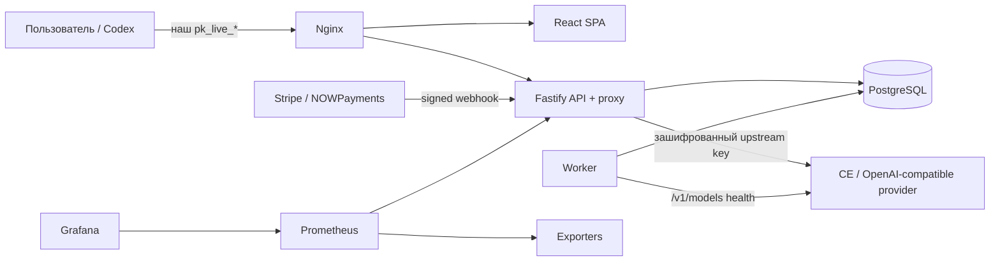

# ProxyKey

TypeScript-сервис для продажи предоплаченных API-ключей поверх Codex Everywhere и других провайдеров. Покупатель платит один раз: вся сумма поступает на баланс ключа и расходуется на доступные модели. Автоматических ежемесячных платежей нет.

Сервис включает React-кабинет и админку, Fastify API/proxy, PostgreSQL, фонового worker, Nginx, Stripe, NOWPayments, Prometheus, Grafana и GitHub Actions CI.

## Коммерческая модель

Два независимых параметра задают экономику:

- `PRICE_MARKUP=2` — множитель для цены пакета и ставок моделей. Например, покупка за `$20` даёт баланс `$20`, а запрос себестоимостью `$0.01` списывает `$0.02`. Допустимо положительное десятичное число, например `1.75`.
- `USERS_PER_UPSTREAM_KEY=2` — сколько активных или зарезервированных покупательских ключей можно закрепить за одним upstream-ключом CE. Дополнительные каналы назначаются при первом запросе и используют такой же лимит мест.

Каждый провайдер имеет собственный `credentialCapacity`, поэтому для CE можно оставить `2`, а для другого OpenAI-compatible сервиса поставить, например, `5` через админку.

Учитываются входные токены, чтение и запись кэша, выходные токены и изображения. В модели можно настроить надбавки за длинный контекст или часы пик. Себестоимость и списание покупателя записываются раздельно.

## Быстрый запуск

Нужны Node.js 24.22.3+ (ветка 24 LTS), Colima, Docker CLI и Docker Compose.

```bash
cp .env.example .env
# Замените пароли и два секрета в .env перед первым запуском.
colima start --cpu 4 --memory 8 --disk 60
docker-compose up -d --build
docker-compose ps
curl http://localhost:8080/health/ready
```

Откройте [ProxyKey](http://localhost:8080) и [публичную документацию](http://localhost:8080/docs). Начальный администратор берётся из `ADMIN_EMAIL` и `ADMIN_PASSWORD`. Добавляйте CE API keys в **Админка → Провайдеры → Добавить upstream-ключ** и выбирайте канал, соответствующий группе каждого ключа. Секреты хранятся в PostgreSQL в зашифрованном виде.

Для автоматического выпуска ключей из пополненного аккаунта CE задайте `CE_AUTO_PROVISION_KEYS=true` и настройте [подключение и группы CE](docs/USAGE_RU.md#автоматический-выпуск-ключей-ce). Значение `false` оставляет ручной режим.

Подробная пошаговая эксплуатация: [docs/USAGE_RU.md](docs/USAGE_RU.md). Результат аудита CE и условия открытия продаж: [Готовность к production](docs/PRODUCTION_READINESS_RU.md).

## Что реализовано

- роли `ADMIN` и `USER`, любое количество администраторов и пользователей;
- регистрация, защищённые cookie-сессии, scrypt-пароли, RU/EN, light/dark/system;
- профиль с почтой и опциональным публичным адресом кошелька; seed-фразы и приватные ключи не принимаются;
- одноразовая продажа ключа, резерв capacity на время оплаты, идемпотентная выдача после webhook;
- цены пакетов в USD с пересчётом в ₽ и TON, карта через Stripe Checkout в USD, Toncoin через NOWPayments, локальная тестовая оплата;
- витрина с GPT, Claude, Gemini, Grok, DeepSeek и GPT Image, калькулятор и конфигурации для Codex, Claude Code, OpenCode, curl и OpenAI SDK;
- история расхода по ключам с разбивкой по входу, кэшу и выходу, статусом запроса и списанием;
- несколько provider pools, несколько зашифрованных upstream-ключей, priority, concurrency, spend limit, health-check и failover;
- `/v1/models` с проверенным каталогом, Responses, Chat Completions, Anthropic Messages, Gemini GenerateContent и Image Generations; клиентские инструменты и SSE без буферизации;
- учёт подтверждённого usage с Decimal-арифметикой и отметками для сверки неподтверждённого расхода;
- email-уведомления о создании ключа, окончании лимита и истечении срока;
- `/health/live`, `/health/ready`, `/health/serving`, Prometheus, PostgreSQL/Nginx exporters, Grafana dashboard и alerts;
- GitHub Actions на `ubuntu-latest`: PostgreSQL 16, Node typecheck, unit/integration tests, audit и production Docker builds;
- публичный `/docs` с RU/EN, готовыми примерами для Codex, curl и OpenAI SDK;
- публичный контракт: [OpenAPI YAML](apps/web/public/openapi.yaml).

## Архитектура



Технические решения и инварианты описаны в [docs/ARCHITECTURE.md](docs/ARCHITECTURE.md).

## Проверки

```bash
npm ci
npm run typecheck
npm test
npm run build
```

Интеграционные тесты с PostgreSQL и локальным имитатором провайдера проверяют маршрутизацию, SSE, списания с одного баланса, выдачу после оплаты и правило двух мест на upstream-ключ. Они включены в CI через `RUN_INTEGRATION_TESTS=true`.

## Важное перед коммерческим запуском

Ответ администратора CE подтверждает технический путь через Sub2API/New API, но перед публичной перепродажей всё равно сохраните отдельное письменное подтверждение разрешения на resale/account sharing и соблюдайте условия каждого upstream, платёжные правила, налоги и требования вашей юрисдикции. В New API и Sub2API также отдельно предупреждают, что оператор отвечает за законность upstream-доступа.

Реальные CE, Stripe, NOWPayments и SMTP credentials намеренно не входят в репозиторий. В `production` новые продажи по умолчанию выключены; включайте `SALES_ENABLED=true` после проверки из [отчёта](docs/PRODUCTION_READINESS_RU.md).
