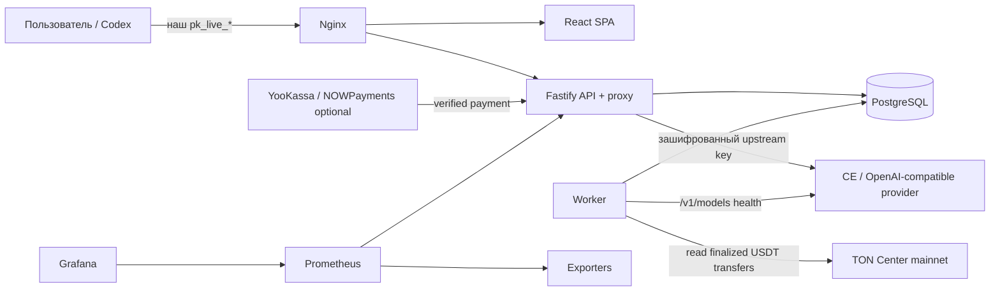

# Ksapi

TypeScript-сервис для продажи предоплаченных API-ключей поверх Codex Everywhere и других провайдеров. Разовая оплата целиком поступает на баланс ключа, общий для доступных моделей. Бессрочный ключ можно пополнять из кабинета.

Сервис включает React-кабинет и админку, Fastify API/proxy, PostgreSQL, фонового worker, Nginx, прямые USDT-переводы TON, ЮKassa, NOWPayments, Prometheus, Grafana и GitHub Actions CI.

API: Responses/Chat Completions для GPT, Grok и совместимых моделей; native Claude Messages и Gemini; подсчёт токенов; генерация и multipart-редактирование изображений; фоновые видео-задачи со статусом, скачиванием и однократным списанием. [Подключение каналов, тарифы медиа, примеры и ограничения](docs/MULTIMODAL_API_RU.md). Публичная документация: `/docs`, `/setup`, `/openapi.yaml`.

На главной: сравнение сценариев Ksapi и ChatGPT Plus (`/#compare`) с датой проверки и официальными источниками. Вопросы, предложения и помощь: [@zybato в Telegram](https://t.me/zybato), ссылка также есть в кабинете и футере. Пользовательское соглашение и подтверждение при регистрации пока не добавлены по решению владельца.

**Для запуска настоящей оплаты:** [что сейчас нужно заполнить и проверить](docs/CRYPTO_LAUNCH_RU.md#что-осталось-сделать-на-текущем-стенде). Основной вариант — прямой USDT TON; NOWPayments для него не требуется.

Первый production-релиз принимает **USDT в сети TON**. [План запуска и расчёт маржи](docs/CRYPTO_LAUNCH_RU.md), [шаблон окружения](deploy/production.env.example). Рублёвая интеграция сохранена, но выключена через `PAYMENT_CURRENCIES=USDT`.

## Коммерческая модель

Два независимых параметра задают экономику:

- `PRICE_MARKUP=2` — множитель для цены пакета и ставок моделей. Например, покупка пакета 20 USDT даёт баланс 20 USDT, а запрос себестоимостью 0.01 USD списывает 0.02 USDT при `BILLING_USDT_PER_USD=1`. Допустимо положительное десятичное число, например `1.75`.
- `USERS_PER_UPSTREAM_KEY=2` — сколько активных или зарезервированных покупательских ключей можно закрепить за одним upstream-ключом CE. Дополнительные каналы назначаются при первом запросе и используют такой же лимит мест.

Каждый провайдер имеет собственный `credentialCapacity`, поэтому для CE можно оставить `2`, а для другого OpenAI-compatible сервиса поставить, например, `5` через админку.

Учитываются входные токены, чтение и запись кэша, выходные токены, изображения и подтверждённая длительность видео. В модели можно настроить надбавки за длинный контекст или часы пик. Себестоимость и списание покупателя записываются раздельно.

Стандартные покупки и пополнения при `PRICE_MARKUP=2`: **1, 2, 5, 20 и 50 USDT**. Рублёвый эквивалент показывается по актуальному курсу USDT/RUB с датой обновления, в том числе при отключённой оплате рублями. Баланс и цена токенов не зависят от валюты оплаты.

## Быстрый запуск

Нужны Node.js 24.22.3+ (ветка 24 LTS), Colima, Docker CLI и Docker Compose.

```bash
cp .env.example .env
# Замените пароли и два секрета в .env перед первым запуском.
colima start --cpu 4 --memory 8 --disk 60
docker-compose up -d --build
docker-compose ps
curl http://localhost:8080/health/ready
```

Откройте [Ksapi](http://localhost:8080) и [публичную документацию](http://localhost:8080/docs). Начальный администратор берётся из `ADMIN_EMAIL` и `ADMIN_PASSWORD`. Добавляйте CE API keys в **Админка → Провайдеры → Добавить upstream-ключ** и выбирайте канал, соответствующий группе каждого ключа. Секреты хранятся в PostgreSQL в зашифрованном виде.

Для автоматического выпуска ключей из пополненного аккаунта CE задайте `CE_AUTO_PROVISION_KEYS=true` и настройте [подключение и группы CE](docs/USAGE_RU.md#автоматический-выпуск-ключей-ce). Значение `false` оставляет ручной режим.

Подробная пошаговая эксплуатация: [docs/USAGE_RU.md](docs/USAGE_RU.md). Результат аудита CE и условия открытия продаж: [Готовность к production](docs/PRODUCTION_READINESS_RU.md).

## Что реализовано

- роли `ADMIN` и `USER`, любое количество администраторов и пользователей;
- регистрация, защищённые cookie-сессии, scrypt-пароли, RU/EN, light/dark/system;
- профиль с почтой и опциональным публичным адресом кошелька; seed-фразы и приватные ключи не принимаются;
- разовая покупка ключа и пополнение того же ключа, резерв места на время оплаты, однократное зачисление подтверждённого платежа;
- цены, баланс и списания в USDT, рублёвые счета с фиксацией курса через ЮKassa (карты / СБП), прямые переводы USDT в сети TON с автоматической проверкой и ручным разбором, альтернативно NOWPayments, локальная тестовая оплата;
- витрина с GPT, Claude, Gemini, Grok, DeepSeek и GPT Image, калькулятор и конфигурации для Codex, Claude Code, OpenCode, curl и OpenAI SDK;
- история расхода по ключам с разбивкой по входу, кэшу и выходу, статусом запроса и списанием;
- несколько provider pools, несколько зашифрованных upstream-ключей, priority, concurrency, spend limit, health-check и failover;
- `/v1/models` с проверенным каталогом, Responses, Chat Completions, Anthropic Messages, Gemini GenerateContent и Image Generations; клиентские инструменты и SSE без буферизации;
- учёт подтверждённого usage с Decimal-арифметикой и отметками для сверки неподтверждённого расхода;
- email-уведомления о создании ключа, окончании лимита и истечении срока;
- автоматическая замена исчерпанного ключа провайдера с сохранением клиентского ключа, контроль баланса аккаунта CE, предупреждения в админке, email и метрики Grafana/Prometheus;
- `/health/live`, `/health/ready`, `/health/serving`, Prometheus, PostgreSQL/Nginx exporters, Grafana dashboard и alerts;
- GitHub Actions на `ubuntu-latest`: PostgreSQL 16, Node typecheck, unit/integration tests, audit и production Docker builds;
- публичный `/docs` с RU/EN, готовыми примерами для Codex, curl и OpenAI SDK;
- публичный контракт: [OpenAPI YAML](apps/web/public/openapi.yaml).

## Оплата прямым переводом USDT (TON)

NOWPayments для этого способа **не нужен**. Покупатель отправляет USDT на ваш кошелёк, а worker сверяет поступление через read-only API TON Center. Приватные ключи и seed-фраза сервису не нужны. Подробная подготовка production: [docs/CRYPTO_LAUNCH_RU.md](docs/CRYPTO_LAUNCH_RU.md).

Когда реквизиты появятся, добавьте их в **локальный `.env` в корне проекта** (на сервере — в его `.env`):

```dotenv
PAYMENT_METHODS=ton
PAYMENT_CURRENCIES=USDT
TON_RECEIVER_ADDRESS=ваш_публичный_адрес_кошелька_TON_mainnet
TONCENTER_API_KEY=ваш_ключ_TON_Center_mainnet
TONCENTER_API_URL=https://toncenter.com/api/v3
TON_AUTO_APPROVE=true
TON_INVOICE_TTL_MINUTES=60
ALLOW_MOCK_PAYMENTS=false
SALES_ENABLED=false
PUBLIC_APP_URL=https://ваш-домен
PRICE_MARKUP=2
BILLING_USDT_PER_USD=1
```

`TON_RECEIVER_ADDRESS` — адрес **вашего кошелька**, способного принимать USDT в TON, а не адрес контракта токена и не адрес биржи с общим memo. Ключ для чтения блокчейна получите в [TON Center](https://toncenter.com). Он не даёт права распоряжаться кошельком. В production также заполните остальные секреты из [deploy/production.env.example](deploy/production.env.example). Не отправляйте `.env` в Git. Если используется существующая БД, сохраните `KEY_ENCRYPTION_SECRET`, иначе старые API-ключи не расшифруются.

После заполнения и проверки конфигурации:

```bash
docker-compose build api worker migrate nginx
docker-compose run --rm migrate
docker-compose up -d --no-deps --force-recreate api worker nginx
docker-compose run --rm --no-deps api node apps/api/dist/ops/production-check.js
```

Продажи пока закрыты (`SALES_ENABLED=false`). На контролируемом staging включите их, проверьте реальный небольшой перевод, выдачу и пополнение ключа, письма и тарифы поставщика. Только после этого включите `SALES_ENABLED=true` на production и пересоздайте API/worker. Без реквизитов `.env` оставляйте в локальном тестовом режиме — не подставляйте адрес из примеров.

Путь покупателя:

1. Выбирает пакет или пополнение → получает сумму, адрес, **уникальный комментарий** и срок счёта.
2. Отправляет точную сумму **USDT в сети TON** одним переводом с открытым комментарием. Комиссию сети оплачивает отдельно; Toncoin вместо USDT не принимается.
3. Worker примерно раз в минуту проверяет завершённые переводы. Совпасть должны контракт настоящего USDT, получатель, сумма, комментарий и срок. После подтверждения выдается ключ или пополняется существующий; повторная обработка не удваивает баланс.
4. Если комментарий пропущен или перевод задержался, покупатель может прислать хеш через страницу заказа. Это заявка на проверку, не доказательство владения переводом.

**Админка → Заказы → Поступления USDT**: состояние сканера, заявки клиентов, проверка транзакции по хешу, ссылка на блокчейн, одобрение/отклонение с обязательным основанием в журнале. Для автоматического платежа достаточно `TON_AUTO_APPROVE=true`. При `false` каждый подтверждённый перевод ждёт администратора; настройку меняйте с пересозданием API/worker. Счета, созданные в ручном режиме, сохраняют ручную проверку.

Неверная сеть/токен, чужой получатель, незавершённый или неуспешный перевод не зачисляются. Недоплата не допускает одобрения; суммы нескольких переводов автоматически не складываются. Переплата и перевод после срока требуют решения администратора: зачисляется только сумма купленного пакета. Отклонение **не отправляет возврат**. Возвраты/излишек отправляйте отдельно из вашего кошелька после сверки. Перевод без комментария нельзя присваивать клиенту только по публичному хешу или скриншоту — сначала подтвердите принадлежность кошелька/перевода.

Смена адреса не теряет старые счета: worker продолжает читать адреса из их реквизитов. При сбое TON Center деньги не зачисляются вслепую; сохранённый курсор позволяет продолжить проверку. Prometheus показывает задержку сканера и очередь ручной проверки; Grafana содержит отдельные панели. Доставку уведомлений по alert-правилам во внешний канал нужно настроить перед запуском.

Если позднее выберете NOWPayments, замените `PAYMENT_METHODS=nowpayments` и заполните `NOWPAYMENTS_API_KEY` / `NOWPAYMENTS_IPN_SECRET` в том же `.env`, оставив `NOWPAYMENTS_PAY_CURRENCY=usdtton`. Для него потребуется доступный HTTPS webhook `/api/webhooks/nowpayments`. Для прямого TON-перевода webhook не нужен.

## Архитектура



Технические решения и инварианты описаны в [docs/ARCHITECTURE.md](docs/ARCHITECTURE.md).

## Проверки

```bash
npm ci
npm run typecheck
npm test
npm run build
```

Интеграционные тесты с PostgreSQL и локальным имитатором провайдера проверяют маршрутизацию, SSE, списания с одного баланса, выдачу после оплаты и правило двух мест на upstream-ключ. Они включены в CI через `RUN_INTEGRATION_TESTS=true`.

## Важное перед коммерческим запуском

Ответ администратора CE подтверждает технический путь через Sub2API/New API, но перед публичной перепродажей всё равно сохраните отдельное письменное подтверждение разрешения на resale/account sharing и соблюдайте условия каждого upstream, платёжные правила, налоги и требования вашей юрисдикции. В New API и Sub2API также отдельно предупреждают, что оператор отвечает за законность upstream-доступа.

Реальные CE, ЮKassa, NOWPayments и SMTP credentials намеренно не входят в репозиторий. В `production` новые продажи по умолчанию выключены; включайте `SALES_ENABLED=true` после проверки из [отчёта](docs/PRODUCTION_READINESS_RU.md).

### RUB и USDT

Баланс ключа ведётся в USDT. При оплате рублями ЮKassa получает фиксированную сумму RUB; заказ хранит курс USDT/RUB и отдельно сумму зачисления USDT. Криптосчёт принимает только USDT в сети TON (`usdtton`). Повторное уведомление не удваивает зачисление.

Миграция `010_rub_usdt_billing.sql` переносит старые остатки 1:1 без уменьшения доступного использования. Валюта прошлых платежей сохраняется; поздние Stripe/Toncoin уведомления проверяются по исходным условиям. Себестоимость и реальный остаток поставщика остаются в его исходных USD для сверки и доступны только администратору. Настройка, тестовый режим ЮKassa и webhooks описаны в [инструкции](docs/USAGE_RU.md#9-включите-реальные-платежи).

Админка также показывает снимок ключей аккаунта CE и их связи с клиентами. Включите `CE_KEY_SYNC_ENABLED=true` и доступ к аккаунту в `.env.ce`. Откройте **Провайдеры → Ключи в аккаунте CE** или нажмите email в **Пользователях**. Подробности и API — в [инструкции](docs/USAGE_RU.md#активные-ключи-ce-и-привязка-к-покупателям).
